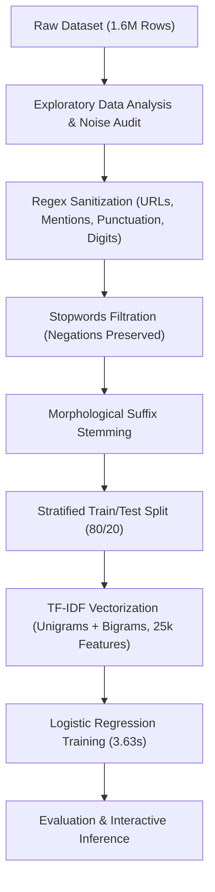

# Sentiment140 Sentiment Analysis Pipeline

[](https://www.python.org/)
[](https://scikit-learn.org/)
[](LICENSE)

An end-to-end, high-performance Natural Language Processing (NLP) and sentiment classification pipeline trained on the full **1.6 million tweets** of the **Sentiment140** corpus. 

This repository implements a modular, reproducible data preprocessing architecture, text sanitization, custom negation-preserving stopword filtering, pure-Python morphological suffix stemming, and bi-gram **TF-IDF** feature extraction combined with an optimized **Logistic Regression** model.

---

## 📌 Project Overview

- **Dataset Scale:** 1,600,000 tweets (800,000 Negative, 800,000 Positive).
- **Why "Sentiment140"?** The name originates from Twitter's historical **140-character limit** per tweet, though the dataset contains 1.6 million records.
- **Model Accuracy:** **`79.45%`** on 320,000 unseen holdout test samples.
- **Training Time:** **`3.63 seconds`** across 1,280,000 training records.
- **Methodology Focus:** Designed to demonstrate and evaluate the full spectrum of NLP data preprocessing techniques taught in modern Data Science and Systems curricula.

---

## 📊 Dataset Access

The dataset can be downloaded directly from Kaggle:
- **Kaggle Dataset Link:** [Sentiment140 Dataset (1.6 Million Tweets)](https://www.kaggle.com/datasets/kazanova/sentiment140)

To run the pipeline locally, place the CSV file (`training.1600000.processed.noemoticon.csv`) in your project or root data directory and ensure the file path in `Code.ipynb` matches its location.

---

## 🚀 Getting Started & Installation

### 1. Clone the Repository
```bash
git clone https://github.com/youssefekrami/sentiment140-pipeline.git
cd sentiment140-pipeline
```

### 2. Install Required Dependencies
Run the `requirements.txt` file to set up all required libraries:
```bash
pip install -r requirements.txt
```

### 3. Run the Pipeline
Open and execute the Jupyter Notebook:
```bash
jupyter notebook Code.ipynb
```

---

## 🛠️ Pipeline Architecture



### Empirical Noise Analysis (1.6M Tweets)
Before cleaning, exploratory regex filters identified the exact prevalence of noise in the corpus:
- **Punctuations & Special Characters:** 1,449,659 tweets (90.6%)
- **User Mentions (`@user`):** 738,491 tweets (46.2%)
- **Multiple Consecutive Whitespaces:** 564,944 tweets (35.3%)
- **Numeric Digits:** 366,487 tweets (22.9%)
- **Hyperlinks (URLs):** 75,693 tweets (4.7%)
- **Hashtags (`#`):** 35,842 tweets (2.2%)

---

## 📈 Benchmark Results

Trained on **1,280,000 tweets** and evaluated on **320,000 unseen test tweets**:

| Class | Precision | Recall | F1-Score | Support |
| :--- | :---: | :---: | :---: | :---: |
| **Negative (0)** | **0.81** | **0.77** | **0.79** | 160,000 |
| **Positive (1)** | **0.78** | **0.82** | **0.80** | 160,000 |
| **Overall Accuracy** | — | — | **79.45%** | 320,000 |

- **Training Wall-Clock Time:** `3.63 seconds`
- **Macro Average F1:** `0.79`
- **Weighted Average F1:** `0.79`

---

## 🧪 Interactive Inference Example

The notebook features a dedicated cell for live testing custom tweet queries:

```python
input_text = "I absolutely love this new update! Everything is working smoothly."

# Output:
# Original Text:  I absolutely love this new update! Everything is working smoothly.
# Preprocessed:   absolut lov updat work smoothli
# Predicted:      Positive (1) :)
# Confidence:     96.18%
```

---

## 📁 Repository Structure

```text
sentiment140-pipeline/
├── Code.ipynb           # Complete Jupyter Notebook with preprocessing and modeling
├── REPORT.md            # Comprehensive academic report with LaTeX documentation
├── README.md            # Repository documentation and guide
└── requirements.txt     # Python environment package dependencies
```

---

## 📄 Academic Report

A complete, formal academic report detailing the theoretical background, mathematical derivations of TF-IDF, step-by-step preprocessing transformations, empirical confusion matrix, and methodological rationale is available in [REPORT.md](REPORT.md).

---

## 👥 Contributors

- **Youssef Ekrami Mofreh** (Phone: `01066472757`)
- **Dareen Ashraf Mosa** (Phone: `01554237770`)
