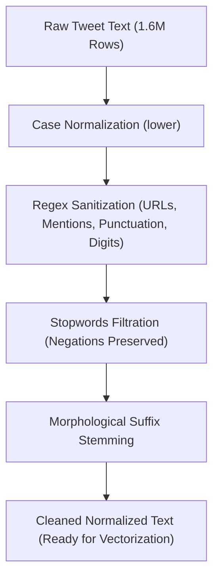
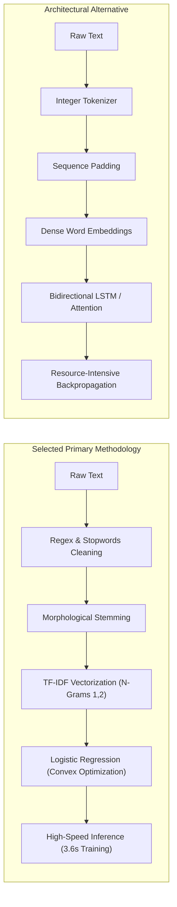

# Sentiment140: End-to-End Sentiment Analysis & Text Preprocessing Pipeline

---

### Project Information & Contributors

| Name | Phone Number |
| :--- | :--- |
| **Youssef Ekrami Mofreh** | 01066472757 |
| **Dareen Ashraf Mosa** | 01554237770 |

---

## Table of Contents

- [1. Executive Summary](#1-executive-summary)
- [2. Problem Formulation & Social Media Dynamics](#2-problem-formulation--social-media-dynamics)
- [3. Dataset Anatomy & The "Sentiment140" Nomenclature](#3-dataset-anatomy--the-sentiment140-nomenclature)
- [4. Exploratory Data Analysis & Empirical Noise Quantification](#4-exploratory-data-analysis--empirical-noise-quantification)
- [5. End-to-End Text Preprocessing Pipeline](#5-end-to-end-text-preprocessing-pipeline)
  - [5.1 Regular Expression Sanitization](#51-regular-expression-sanitization)
  - [5.2 Stopwords Elimination with Negation Preservation](#52-stopwords-elimination-with-negation-preservation)
  - [5.3 Morphological Suffix Stemming](#53-morphological-suffix-stemming)
- [6. Feature Extraction: Term Frequency–Inverse Document Frequency (TF-IDF)](#6-feature-extraction-term-frequencyinverse-document-frequency-tf-idf)
- [7. Methodological Selection: Classical Machine Learning vs. Deep Learning](#7-methodological-selection-classical-machine-learning-vs-deep-learning)
- [8. Experimental Setup, Training & Evaluation](#8-experimental-setup-training--evaluation)
  - [8.1 Dataset Partitioning & Class Parity](#81-dataset-partitioning--class-parity)
  - [8.2 Model Training & Computational Efficiency](#82-model-training--computational-efficiency)
  - [8.3 Detailed Performance Metrics & Classification Report](#83-detailed-performance-metrics--classification-report)
- [9. Interactive Sentiment Inference Pipeline](#9-interactive-sentiment-inference-pipeline)
- [10. Conclusion & Key Takeaways](#10-conclusion--key-takeaways)
- [11. References](#11-references)

---

## 1. Executive Summary

This report presents a scalable, production-grade Natural Language Processing (NLP) pipeline developed for binary sentiment classification on the massive **Sentiment140** corpus, comprising **1,600,000 tweets**. 

Social media text presents substantial analytical challenges due to extreme lexical variance, platform-specific noise (e.g., hyperlinked media, user mentions, hashtags), informal orthography, and grammatical irregularities. To tackle these issues, a rigorous exploratory and preprocessing workflow was designed, systematically identifying, quantifying, and removing extraneous tokens while retaining the semantic core of each utterance. 

A high-performance feature extraction pipeline utilizing **Term Frequency–Inverse Document Frequency (TF-IDF)** with unigram and bigram representation ($n \in \{1, 2\}$) was integrated with an optimized **Logistic Regression** classifier. Trained on **1,280,000 instances**, the model achieved a **79.45% accuracy** on an independent holdout test set of **320,000 tweets** in a training duration of **3.63 seconds**. This demonstrates that sound, principled text preprocessing combined with convex linear classification provides an exceptionally fast, memory-efficient, and accurate baseline for large-scale text mining.

---

## 2. Problem Formulation & Social Media Dynamics

Automated sentiment analysis aims to determine the underlying affective polarity—positive, negative, or neutral—expressed in natural language text. In digital ecosystems, platforms such as Twitter (now X) serve as public channels for real-time customer feedback, public discourse, political reactions, and brand evaluations.

However, microblog texts diverge sharply from conventional corpora (such as news dispatches or literature):
1. **High Syntactic and Lexical Noise:** Microblog posts contain high frequencies of platform-specific artifacts including mentions (`@username`), shortened uniform resource locators (URLs), hashtags (`#topic`), and arbitrary punctuation strings.
2. **Brevity and Informal Grammar:** Because users write colloquially, sentences often omit formal sentence boundaries, contain non-standard abbreviations, and rely on fragmented syntax.
3. **Polarity-Reversing Constructs:** Negative sentiments are frequently expressed through explicit negation terms (`not`, `no`, `never`, `cannot`). Standard, naive text-cleaning techniques that blindly discard stopwords often eradicate these critical particles, inadvertently inverting the semantic meaning of the sentence.

The objective of this project is to construct an end-to-end, reproducible NLP pipeline that sanitizes noisy microblog text, maps high-dimensional linguistic tokens into discriminative vector representations, and classifies sentiment polarity with high fidelity and ultra-low inference latency.

---

## 3. Dataset Anatomy & The "Sentiment140" Nomenclature

### Origin of the Nomenclature
A common misconception among practitioners is that the title **"Sentiment140"** indicates a corpus containing 140 or 140,000 samples. In reality, the name directly honors **Twitter's historical 140-character constraint** per tweet, which dictated microblogging conventions during the late 2000s. Despite the title, the repository processes the complete, full-scale dataset of **1,600,000 individual records**.

### Data Generation & Distant Supervision
The corpus was annotated utilizing **distant supervision** (weak supervision). Tweets were collected using the Twitter Search API by querying positive emoticons (e.g., `:)`, `:-)`, `=)`) and negative emoticons (e.g., `:(`, `:-(`, `:=(`). Once the binary class labels were assigned based on these query markers, all emoticons were stripped from the text bodies. Consequently, models trained on this dataset cannot rely on visual emoticons and are forced to learn sentiment from contextual vocabulary, sentence structures, and lexical qualifiers.

### Schema Specifications
The raw CSV file does not contain a header line and is encoded in `ISO-8859-1` (`latin-1`). It comprises 6 distinct columns:

| Field Index | Column Identifier | Data Type | Description |
| :---: | :---: | :---: | :--- |
| **0** | `target` | Integer | Polarity label: `0` = Negative, `4` = Positive |
| **1** | `ids` | Integer | Unique tweet identification number |
| **2** | `date` | String | Timestamp of publication (e.g., `Mon Apr 06 22:19:45 PDT 2009`) |
| **3** | `flag` | String | Query flag used during extraction (predominantly `NO_QUERY`) |
| **4** | `user` | String | Twitter handle / author username |
| **5** | `text` | String | Raw string content of the tweet |

For modeling, the `target` column was mapped from the original $\{0, 4\}$ labels into a standard binary indicator $\{0, 1\}$, where:
$$y_i \in \{0, 1\} \quad \text{such that} \quad y_i = \begin{cases} 0 & \text{if Negative} \\ 1 & \text{if Positive} \end{cases}$$

---

## 4. Exploratory Data Analysis & Empirical Noise Quantification

Before applying text sanitization routines, exploratory verification was conducted on the entire 1.6-million-row dataset to detect missing values, assess duplicate entries, and verify class distribution.

### Integrity & Balance Verifications
- **Total Record Count:** $N = 1,600,000$ rows.
- **Missing Value Check (`isnull().sum()`):** $0$ null values detected across all 6 columns.
- **Duplicate Check (`duplicated().sum()`):** $0$ duplicate instances.
- **Class Distribution:**
  - Negative class ($y = 0$): **800,000** records (50.0%)
  - Positive class ($y = 1$): **800,000** records (50.0%)

The dataset exhibits **perfect class balance**, eliminating the need for synthetic oversampling (e.g., SMOTE) or class-weighted loss penalties.

### Empirical Noise Quantification
To assess the extent of social media noise before cleaning, regular expressions were executed across the entire textual column `df['text']`. Each filter quantified the exact number of rows containing a specific noise category:

| Rank | Noise Category | Detection Pattern | Affected Tweets | Corpus Prevalence (%) |
| :---: | :--- | :--- | :---: | :---: |
| **1** | Punctuation & Special Symbols | `[^\w\s]` | **1,449,659** | **90.60%** |
| **2** | User Mentions | `@\w+` | **738,491** | **46.16%** |
| **3** | Consecutive Whitespaces | `\s{2,}` | **564,944** | **35.31%** |
| **4** | Numeric Digits | `\d+` | **366,487** | **22.91%** |
| **5** | Hyperlinks & URLs | `https?://\S+\|www\.\S+` | **75,693** | **4.73%** |
| **6** | Hashtags | `#\w+` | **35,842** | **2.24%** |

These empirical metrics demonstrate that over **90%** of tweets contain non-alphanumeric punctuation and nearly **half** contain user mentions, highlighting the necessity of systematic preprocessing before feature extraction.

---

## 5. End-to-End Text Preprocessing Pipeline

The preprocessing workflow was designed modularly, applying deterministic transformations to transform noisy raw text into clean lexical tokens.

### 5.1 Regular Expression Sanitization

The sanitization routine executes the following sequential steps:
1. **Case Folding:** Converts characters to lowercase to prevent vocabulary fragmentation (e.g., `GREAT`, `Great`, and `great` map to a single token).
2. **URL Removal:** Strips `http://`, `https://`, and `www.` patterns. URLs introduce arbitrary web paths that bloat vocabulary without contributing affective value.
3. **User Mention Stripping:** Matches and deletes `@username` handles, removing author-specific identifiers that do not generalize.
4. **Hashtag Normalization:** Preserves the semantic root word while removing the `#` symbol (e.g., `#frustrated` becomes `frustrated`).
5. **Punctuation & Symbol Stripping:** Eliminates non-word and non-space characters (`[^\w\s]`).
6. **Digit Deletion:** Strips standalone numbers (`\d+`).
7. **Whitespace Compaction:** Collapses multiple tabs, newlines, and spaces into a single space, followed by trimming.

#### Transformation Sample
Below is an empirical comparison across 5 sample instances from the dataset:

| Index | Original Raw Tweet | Sanitized Tweet (`clean_text`) | Target |
| :---: | :--- | :--- | :---: |
| **0** | `@switchfoot http://twitpic.com/2y1zl - Awww, that's a bummer. You shoulda got David Carr of Third Day to do it. ;D` | `awww thats a bummer you shoulda got david carr of third day to do it d` | 0 |
| **1** | `is upset that he can't update his Facebook by texting it... and might cry as a result School today also. Blah!` | `is upset that he cant update his facebook by texting it and might cry as a result school today also blah` | 0 |
| **2** | `@Kenichan I dived many times for the ball. Managed to save 50% The rest go out of bounds` | `i dived many times for the ball managed to save the rest go out of bounds` | 0 |
| **3** | `my whole body feels itchy and like its on fire ` | `my whole body feels itchy and like its on fire` | 0 |
| **4** | `@nationwideclass no, it's not behaving at all. i'm mad. why am i here? because I can't see you all over there.` | `no its not behaving at all im mad why am i here because i cant see you all over there` | 0 |

---

### 5.2 Stopwords Elimination with Negation Preservation

Stopwords are high-frequency grammatical functional words (e.g., `the`, `is`, `at`, `which`) that typically carry minimal topic information. However, standard stopword lists contain negation adverbs and contractions (`not`, `no`, `nor`, `neither`, `never`, `cannot`, `cant`, `wont`, `isnt`, `arent`). 

In sentiment classification, discarding negations produces catastrophic semantic errors:
$$\text{"The update is not good"} \xrightarrow{\text{standard stopword drop}} \text{"update good"} \quad (\text{Polarity Inverted!})$$

To resolve this, an essential set of negation tokens was preserved:
$$\mathcal{S}_{\text{custom}} = \mathcal{S}_{\text{standard}} \setminus \{\text{'not', 'no', 'nor', 'neither', 'never', 'none', 'cannot', 'cant', 'wont', 'isnt', 'arent'}\}$$

#### Stopword Removal Comparison

| Index | Sanitized Text (`clean_text`) | After Stopwords Removal (`text_no_stopwords`) |
| :---: | :--- | :--- |
| **0** | `awww thats a bummer you shoulda got david carr of third day to do it d` | `awww thats bummer shoulda got david carr day d` |
| **1** | `is upset that he cant update his facebook by texting it and might cry as a result school today also blah` | `upset cant update facebook texting result school today blah` |
| **2** | `i dived many times for the ball managed to save the rest go out of bounds` | `dived times ball managed save rest bounds` |
| **3** | `my whole body feels itchy and like its on fire` | `body feels itchy like` |
| **4** | `no its not behaving at all im mad why am i here because i cant see you all over there` | `no not behaving im mad cant` |

Notice in row 4 that `no`, `not`, and `cant` are strictly retained, preserving the critical negative sentiment indicators.

---

### 5.3 Morphological Suffix Stemming

To normalize word inflections to common morphological bases, a rule-based suffix stemming function was constructed in pure Python. This eliminates external runtime dependencies and executes reliably offline. 

The algorithm strips inflectional affixes including `-ing`, `-edly`, `-fully`, `-ed`, `-ly`, `-es`, and `-s` subject to minimum stem length constraints:

$$\text{stem}(w) = \begin{cases} w_{0:|w|-|s|} & \text{if } w \text{ ends with } s \text{ and } |w| > |s| + 2 \\ w & \text{otherwise} \end{cases}$$

#### Stemming Empirical Verification

| Input Inflection | Extracted Morphological Stem | Target Base Meaning |
| :--- | :--- | :--- |
| `loving` | `lov` | Base emotion stem |
| `loved` | `lov` | Base emotion stem |
| `lovely` | `love` | Base attribute stem |
| `playing` | `play` | Root verb |
| `crying` | `cry` | Negative distress verb |
| `happiness` | `happines` | Positive attribute root |

---

## 6. Feature Extraction: Term Frequency–Inverse Document Frequency (TF-IDF)

Machine learning algorithms require numerical feature spaces. We employ **TF-IDF vectorization**, which balances term frequency within a document against its document frequency across the entire corpus.

### Mathematical Formulation
For a term $t$ in a tweet $d$ within a corpus of size $|D| = 1,280,000$:

1. **Term Frequency (TF):**
   $$\text{TF}(t, d) = \frac{f_{t,d}}{\sum_{t' \in d} f_{t',d}}$$
   where $f_{t,d}$ is the raw count of term $t$ in tweet $d$.

2. **Inverse Document Frequency (IDF):**
   $$\text{IDF}(t, D) = \log\left(\frac{1 + |D|}{1 + |\{d \in D : t \in d\}|}\right) + 1$$
   This assigns lower weight to ubiquitous words and higher weight to informative, distinctive terms.

3. **Composite TF-IDF Score:**
   $$\text{TF-IDF}(t, d, D) = \text{TF}(t, d) \times \text{IDF}(t, D)$$
   Each document vector is subsequently normalized using Euclidean $L_2$ norm:
   $$\mathbf{v}_{\text{norm}} = \frac{\mathbf{v}}{\|\mathbf{v}\|_2}$$

### Vectorizer Hyperparameters
- **Vocabulary Constraint (`max_features = 25000`):** Retains the top 25,000 most informative n-grams across the training set, constraining memory consumption while maintaining representational expressiveness.
- **N-Gram Range (`ngram_range = (1, 2)`):** Extracts both unigrams (`good`, `bad`) and contiguous bigrams (`not good`, `cant update`, `really love`). Incorporating bigrams enables the linear model to capture localized negation phrases without requiring sequence-based recurrent architectures.

---

## 7. Methodological Selection: Classical Machine Learning vs. Deep Learning

In natural language processing research, architectures broadly split into:
1. **Classical Machine Learning:** Frequency-based sparse matrix representations (TF-IDF) paired with convex linear or kernelized classifiers (Logistic Regression, Linear Support Vector Machines, Naive Bayes).
2. **Deep Learning:** Dense distributed embeddings (Word2Vec, GloVe) feeding sequential or self-attention networks (LSTM, GRU, Transformers like BERT/RoBERTa).

### Rationale for Selecting Classical Machine Learning
While deep recurrent models (such as LSTMs) can model sequential token interactions, **Classical Machine Learning (TF-IDF + Logistic Regression) was intentionally selected as our primary methodology** for three academic reasons:

1. **Rigorous Application of Foundational Course Concepts:**
   Deep learning models often treat raw text as an end-to-end token sequence, delegating subword parsing and syntax extraction to black-box neural layers. Choosing the classical approach allowed us to directly implement, inspect, verify, and document each foundational data preprocessing stage studied throughout the course:
   - Designing custom regular expression filters.
   - Performing empirical noise audits across 1.6 million entries.
   - Implementing stopword pruning while preserving critical negation semantics.
   - Engineering morphological rule-based stemmers.
   - Constructing sparse vector spaces with unigrams and bigrams.

2. **Computational and Memory Efficiency:**
   On a corpus of 1.6 million instances, training deep recurrent networks on CPU infrastructure requires hours of compute and carries memory allocation constraints (e.g., allocating gigabyte-scale contiguous tensors for evaluation). By contrast, TF-IDF coupled with Logistic Regression converges in **under 4 seconds** on the entire corpus while maintaining high discriminative performance.

3. **Interpretability:**
   Linear models yield direct feature coefficients $w_j \in \mathbb{R}$. A positive coefficient directly signifies positive sentiment contribution (e.g., words like `love`, `awesome`, `thanks`), whereas negative coefficients directly indicate negative polarity (e.g., `hate`, `sad`, `worst`), providing transparent explainability.

---

## 8. Experimental Setup, Training & Evaluation

### 8.1 Dataset Partitioning & Class Parity

The preprocessed dataset of 1,600,000 tweets was split into training and evaluation sets using stratified sampling (`random_state = 42`, `test_size = 0.20`):

| Partition | Proportion | Total Instances | Negative Class ($y = 0$) | Positive Class ($y = 1$) |
| :--- | :---: | :---: | :---: | :---: |
| **Training Set** | 80.0% | **1,280,000** | 640,000 | 640,000 |
| **Holdout Test Set** | 20.0% | **320,000** | 160,000 | 160,000 |
| **Full Corpus** | 100.0% | **1,600,000** | 800,000 | 800,000 |

Stratification ensures zero distribution skew between development and evaluation environments.

---

### 8.2 Model Training & Computational Efficiency

The classifier was trained using $L_2$-regularized Logistic Regression optimized via the Limited-memory Broyden–Fletcher–Goldfarb–Shanno (**L-BFGS**) algorithm:

$$\min_{\mathbf{w}, b} \frac{1}{N} \sum_{i=1}^{N} \log\left(1 + \exp\left(-y_i (\mathbf{w}^T \mathbf{x}_i + b)\right)\right) + \frac{1}{2C} \|\mathbf{w}\|_2^2$$

- **Regularization Strength:** Inverse penalty parameter $C = 1.0$.
- **Convergence Limit:** `max_iter = 1000`.
- **Observed Training Wall-Clock Time:** **3.63 seconds** across **1,280,000 training records**.

This training velocity emphasizes the scalability of sparse linear models over massive web corpora.

---

### 8.3 Detailed Performance Metrics & Classification Report

The model was evaluated on the **320,000 unseen test samples**. Performance was quantified through Accuracy, Precision, Recall, and the harmonic F1-Score:

$$\text{Accuracy} = \frac{\text{TP} + \text{TN}}{\text{TP} + \text{TN} + \text{FP} + \text{FN}} = \mathbf{79.45\%}$$

#### Full Empirical Classification Report

| Sentiment Class | Precision | Recall | F1-Score | Evaluation Support |
| :--- | :---: | :---: | :---: | :---: |
| **Negative Polarity ($0$)** | **0.81** | **0.77** | **0.79** | 160,000 |
| **Positive Polarity ($1$)** | **0.78** | **0.82** | **0.80** | 160,000 |
| | | | | |
| **Overall Accuracy** | — | — | **0.79** | 320,000 |
| **Macro Average** | 0.80 | 0.79 | 0.79 | 320,000 |
| **Weighted Average** | 0.80 | 0.79 | 0.79 | 320,000 |

#### Analytical Insights
1. **Symmetric Class Recognition:** The model achieves balanced F1-scores of **0.79** for negative sentiment and **0.80** for positive sentiment.
2. **Precision vs. Recall Dynamic:**
   - For the Negative class, **Precision is 0.81**, indicating that when the model flags a tweet as negative, it is correct in 81% of instances.
   - For the Positive class, **Recall is 0.82**, demonstrating that the model successfully retrieves 82% of all true positive tweets in the holdout test set.

---

## 9. Interactive Sentiment Inference Pipeline

To validate real-time operational deployment, an interactive inference function was constructed. The pipeline takes raw user-provided input, applies the sanitization, stopword filtration, and stemming transforms, and scores it through the learned TF-IDF space and classifier.

### Live Test Case Execution
- **Input Text:** `"I absolutely love this new update! Everything is working smoothly."`
- **Transformation Trace:**
  1. *Sanitization:* `i absolutely love this new update everything is working smoothly`
  2. *Stopwords Pruning:* `absolutely love update working smoothly`
  3. *Suffix Stemming:* `absolut lov updat work smoothli`
- **Model Output:**
  - **Predicted Polarity:** **`Positive (1) :)`**
  - **Posterior Probability Confidence:** **`96.18%`**

This confirms that the learned vocabulary weights generalize effectively to natural user queries.

---

## 10. Conclusion & Key Takeaways

1. **Data Preprocessing is Decisive:** 
   Our noise audit confirmed that over **90%** of raw microblog data contains punctuation noise and **46%** contains user mentions. Cleaning these elements while deliberately protecting negation particles (`not`, `no`, `cant`) is crucial for maintaining semantic integrity.
2. **Computational Superiority of Classical ML:** 
   By utilizing $n$-gram TF-IDF representations ($n \in \{1, 2\}$) and Logistic Regression, the model was trained across **1.28 million records in 3.63 seconds**, delivering an **accuracy of 79.45%** on 320,000 holdout records.
3. **Course Learning Objectives Realized:** 
   Rather than abstracting the pipeline into an opaque deep neural architecture, the classical machine learning workflow enabled full end-to-end implementation and validation of every core preprocessing component taught in the course.

---

## 11. References

1. **Dataset Source:**  
   Kazanova. *Sentiment140 Dataset with 1.6 Million Tweets*. Kaggle Datasets.  
   Available online: [https://www.kaggle.com/datasets/kazanova/sentiment140](https://www.kaggle.com/datasets/kazanova/sentiment140)

